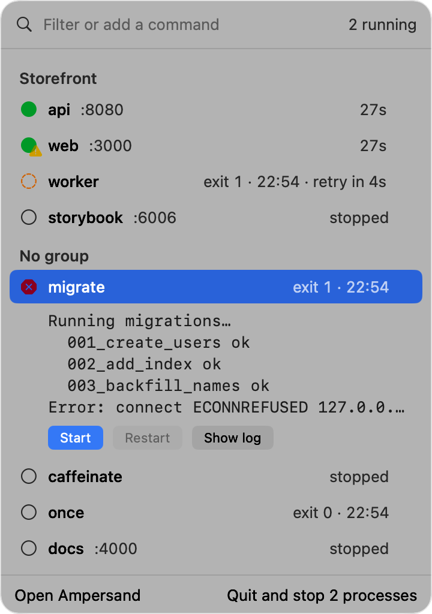
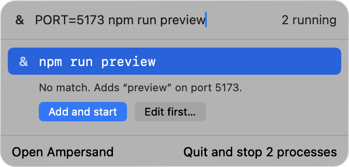
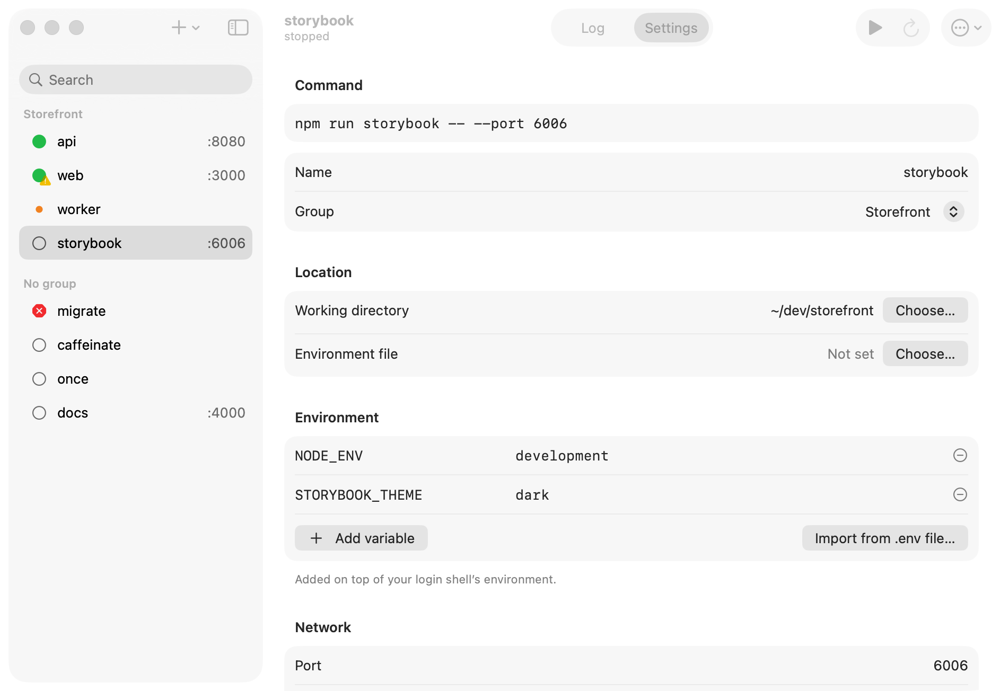
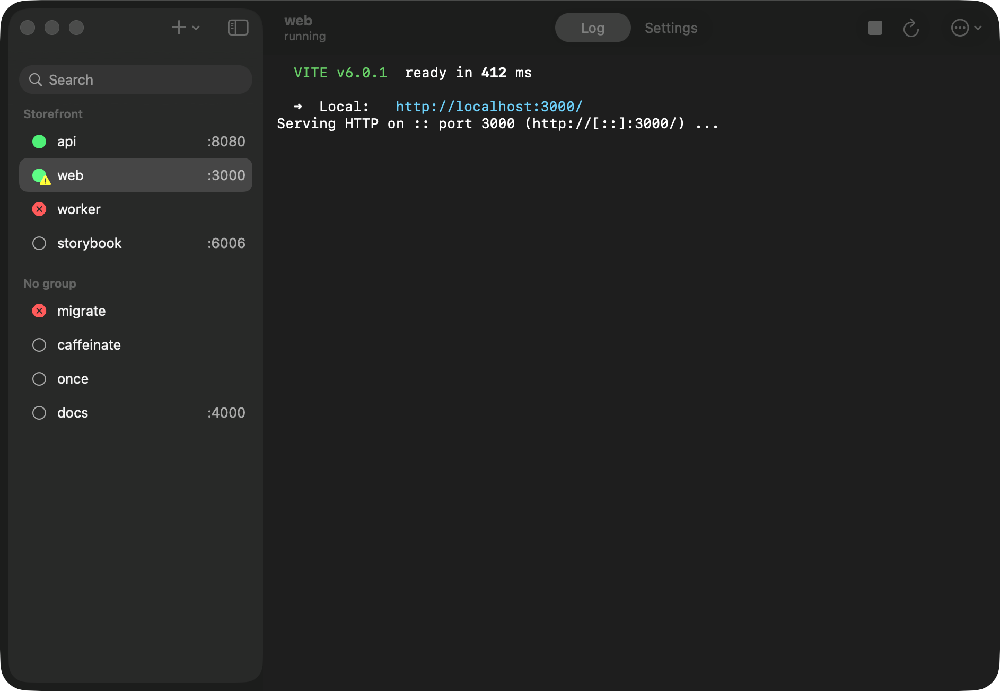

<p align="center">
  <picture>
    <source media="(prefers-color-scheme: dark)" srcset="docs/brand/banner-dark.png">
    
  </picture>
</p>

<p align="center"><em>The <code>&amp;</code> you put after a command, made visible.</em></p>

<p align="center">
  <a href="https://github.com/chriskievit/ampersand/releases/latest"></a>
  
  
  <a href="https://github.com/chriskievit/ampersand/actions/workflows/ci.yml"></a>
  <a href="LICENSE"></a>
</p>

Ampersand is a native macOS menu bar app for the commands you would otherwise
leave running in a terminal tab: `kubectl port-forward`s, `caffeinate`,
`npm run dev`. Start, watch and stop them from the menu bar, read their logs,
and let Ampersand restart them when they crash. Quit Ampersand, and everything
it started stops with it.

<p align="center">
  <picture>
    <source media="(prefers-color-scheme: dark)" srcset="docs/screenshots/popover-dark.png">
    
  </picture>
</p>

## Why Ampersand

Ampersand is built with SwiftUI and AppKit, so it is fast and uses standard
controls, menus and system colours, with grouped forms like System Settings.
When a custom design and the platform disagree, the platform wins.

It stays out of your way. There is no Dock icon until you open the window, and
the menu bar icon shows only how many commands are active, plus a mark when one
needs you.

Commands run through your login shell on a pseudo-terminal, so `PATH`, `nvm`,
kubectl contexts, aliases and colours behave as they do when you type them by
hand. Everything Ampersand starts stops when it quits. The scope is small on
purpose: commands and one level of groups, without tags, dashboards or plugins.

## Features

### At a glance

- One row per command with a status glyph (running, starting, crashed,
  stopped, finished), its port and its uptime. CPU and memory show on the row
  only when they are high (from 50 % CPU or 1 GB).
- The selected row expands to show its CPU, memory and the last lines of its
  log.
- The menu bar icon shows how many commands are active (you can hide the
  number in Settings) and a crash mark when something needs you.
- Filter as you type. Groups keep related commands together, and you can
  start or stop a whole group at once.

### Keeps things running

- Restart on crash, with backoff of 1, 2, 4, 8, 16, 32 and 60 seconds. After
  5 crashes in 2 minutes Ampersand gives up and tells you. A minute of stable
  uptime resets the count.
- A macOS notification when a command crashes.
- Health checks: a port that accepts connections, or a URL that responds.
- When a command's port is already taken, Ampersand names the process that
  holds it.
- A command that exits with status 0 shows as finished. Ampersand does not
  restart it or notify you.

### Fast to set up

- Type or paste a command into the popover's filter field. When it matches
  nothing, <kbd>↩</kbd> adds it and starts it; <kbd>⌥↩</kbd> opens it in the
  editor first.

  <picture>
    <source media="(prefers-color-scheme: dark)" srcset="docs/screenshots/prompt-dark.png">
    
  </picture>

- Paste a command line into the editor and Ampersand suggests a name, a port and a health
  check. A `kubectl port-forward svc/api 8080:80` becomes `api` on port 8080
  with a TCP check.
- **Add from project folder** reads `package.json` scripts and proposes
  commands with their working directory and port.
- **Run once** tries a command inside the editor before you save it.
- Per command: working directory, environment variables, a `.env` file, start
  when Ampersand launches, and restart on crash.
- Every edit applies immediately and can be undone with <kbd>⌘Z</kbd>.

### Logs

- Live stdout and stderr per command, with ANSI colours, 10,000 lines deep.
- Clear, copy or export a log. Long floods are throttled so the app stays
  responsive even under `yes`.

### Session-scoped, no leftovers

- Each command runs in its own process group. Stop sends `SIGTERM` to the
  whole group, then `SIGKILL` after 5 seconds.
- Quitting Ampersand stops everything it started.
- If Ampersand itself is killed, the next launch finds and stops what it left
  behind, matched by process start time so it never touches an unrelated
  process that reused the ID.

## Install

**Requirements:** macOS 26 Tahoe or later on Apple silicon.

1. Download `Ampersand-x.y.z.dmg` from the
   [latest release](https://github.com/chriskievit/ampersand/releases/latest)
   and open it.
2. Drag Ampersand onto the Applications folder in the window that opens.
3. Open Ampersand from Applications. The first time, macOS blocks it (see below).

### "Apple could not verify Ampersand"

Ampersand is free and open source. It is signed ad hoc, not with a paid Apple
Developer ID, so it is not notarized and Gatekeeper blocks the first launch.
To allow it:

1. Open Ampersand once and close the warning.
2. Open **System Settings ▸ Privacy & Security**.
3. Scroll to the message about Ampersand and click **Open anyway**, then
   confirm with your password or Touch ID.

You only do this once. If you prefer the terminal:

```bash
xattr -dr com.apple.quarantine /Applications/Ampersand.app
```

You can also build Ampersand yourself, which takes about a minute.

### Build from source

You need Xcode 26 (Swift 6.2).

```bash
git clone https://github.com/chriskievit/ampersand.git
cd ampersand
scripts/install.sh   # release build into /Applications
```

## Keyboard

In the menu bar popover:

| Keys | Action |
| --- | --- |
| <kbd>↑</kbd> <kbd>↓</kbd> | Select a command |
| <kbd>⌘1</kbd>…<kbd>⌘9</kbd> | Jump to a command (hold <kbd>⌘</kbd> to see the numbers) |
| <kbd>↩</kbd> | Start or stop the selected command, or add the typed command |
| <kbd>⌥↩</kbd> | Start or stop its group, or edit the typed command first |
| <kbd>⌘R</kbd> | Restart |
| <kbd>⌘L</kbd> | Show the full log |
| <kbd>⌘O</kbd> | Open its port in the browser |
| <kbd>⌘D</kbd> | Duplicate |
| <kbd>⌘N</kbd> | New command |
| <kbd>⌘Z</kbd> | Undo |
| <kbd>⌘,</kbd> | Settings |
| <kbd>esc</kbd> | Clear the filter, then close |

In the window, the same actions live in the **Command** and **Log** menus,
plus <kbd>⌘E</kbd> to edit, <kbd>⌥⌘↑</kbd> <kbd>⌥⌘↓</kbd> to reorder,
<kbd>⌘K</kbd> to clear the log, <kbd>⇧⌘N</kbd> to add from a project folder,
and <kbd>⌥⌘1</kbd> <kbd>⌥⌘2</kbd> to switch between the log and the command
settings.

## Gallery

#### Command settings, in the style of System Settings

<picture>
  <source media="(prefers-color-scheme: dark)" srcset="docs/screenshots/window-settings-dark.png">
  
</picture>

#### Live logs, with the colours your tools print



## How it works

Each command runs as `$SHELL -l -i +m -c "<command>"` on its own pseudo-terminal,
spawned with `posix_spawn` as the leader of a new session. That gives it your
login environment and real terminal output (colours, progress bars), and
gives Ampersand a single process group to signal. A supervisor per command
owns the lifecycle: starting, health, restart backoff and stopping. CPU and
memory are sampled across the whole process tree, so `npm run dev` counts its
children too.

The full design lives in [`docs/superpowers/specs`](docs/superpowers/specs),
with the product brief in [`PRODUCT.md`](PRODUCT.md) and the design system in
[`DESIGN.md`](DESIGN.md).

## FAQ

**Why macOS 26 only?** Ampersand is built on the current SwiftUI and its
Liquid Glass look. Supporting older systems would mean a second, worse UI.

**Does it keep commands running after I quit?** No. Quitting Ampersand stops
every command it started. For something that should outlive your session, use
a system service manager.

**Which shell does it use?** Your login shell (`$SHELL`), as a login,
interactive shell, so your `.zprofile` and `.zshrc` are read the same way as in
Terminal.

**Where is my configuration?** In
`~/Library/Application Support/Ampersand/config.json`. It is plain JSON.
Quit Ampersand before you edit it by hand, or use **File ▸ Import…** and
**File ▸ Export…** to move it between Macs.

## Stack

- Swift 6.2 with strict concurrency, built with Swift Package Manager
- SwiftUI, with AppKit where SwiftUI falls short
- Swift Testing for the `AmpersandCore` library
- No third-party dependencies

## Scripts

| Command | Description |
| --- | --- |
| `scripts/run.sh` | Debug build, then launch it |
| `scripts/install.sh` | Release build into `/Applications` |
| `scripts/bundle.sh [debug\|release]` | Build `build/Ampersand.app` (compiles the icon, signs ad hoc) |
| `scripts/release.sh <version>` | Versioned, zipped build, as used by the release workflow |
| `swift test` | Run the test suite |

## Uninstall

Turn off **Launch at login** in Ampersand's settings, quit it, then:

```bash
rm -rf /Applications/Ampersand.app ~/Library/Application\ Support/Ampersand
```

## Contributing

Bug reports and pull requests are welcome. Read
[CONTRIBUTING.md](CONTRIBUTING.md) first: it explains how to build and test,
and what CI expects.

## License

[MIT](LICENSE) © 2026 Chris Kievit
